<a id="paper"></a>

# EchoDino: A pediatric foundation model for transferable echocardiographic analysis across the lifespan

Sheng Cheng, Donnchadh M. O'Sullivan, Daniel J. Penny, Craig G. Rusin, Minh B. Nguyen, and Devika Subramanian.

**Contents:** [Paper](#paper) · [Examples](#examples) · [Install](#installation) · [Training](#training)

## Abstract

Echocardiography is the most widely used cardiac imaging modality, yet interpretation demands integrating visual evidence across global anatomy, localized structures and dynamic cardiac motion. Machine-learning models have automated individual tasks, but they are typically built for a single purpose and depend on expensively labeled datasets—a barrier particularly acute in pediatric care, where data are scarce and anatomy changes with age. Here we present EchoDino, a self-supervised foundation model for echocardiography, created by adapting the DINOv3 framework to 3.7 million frames from 1.7 million unlabeled pediatric echocardiography videos. With its encoder frozen, EchoDino produces representations that capture global context, local anatomy, and dense spatial detail. We introduce Motion-biased Entropy Maximization Sampling (MEMS) to select the most informative frames for video-level analysis. Across nine pediatric and adult datasets, EchoDino outperformed strong baseline models, raising view-classification accuracy from 0.609 to 0.889 and the area under the receiver operating characteristic curve for structural-heart-disease detection from 0.811 to 0.872, while also cutting age-estimation error by 2.47 years, achieving the best segmentation accuracy and lowering ejection-fraction errors. By generalizing from label-free pediatric data to adult echocardiography, EchoDino offers a versatile foundation for cardiac image analysis across the lifespan.

[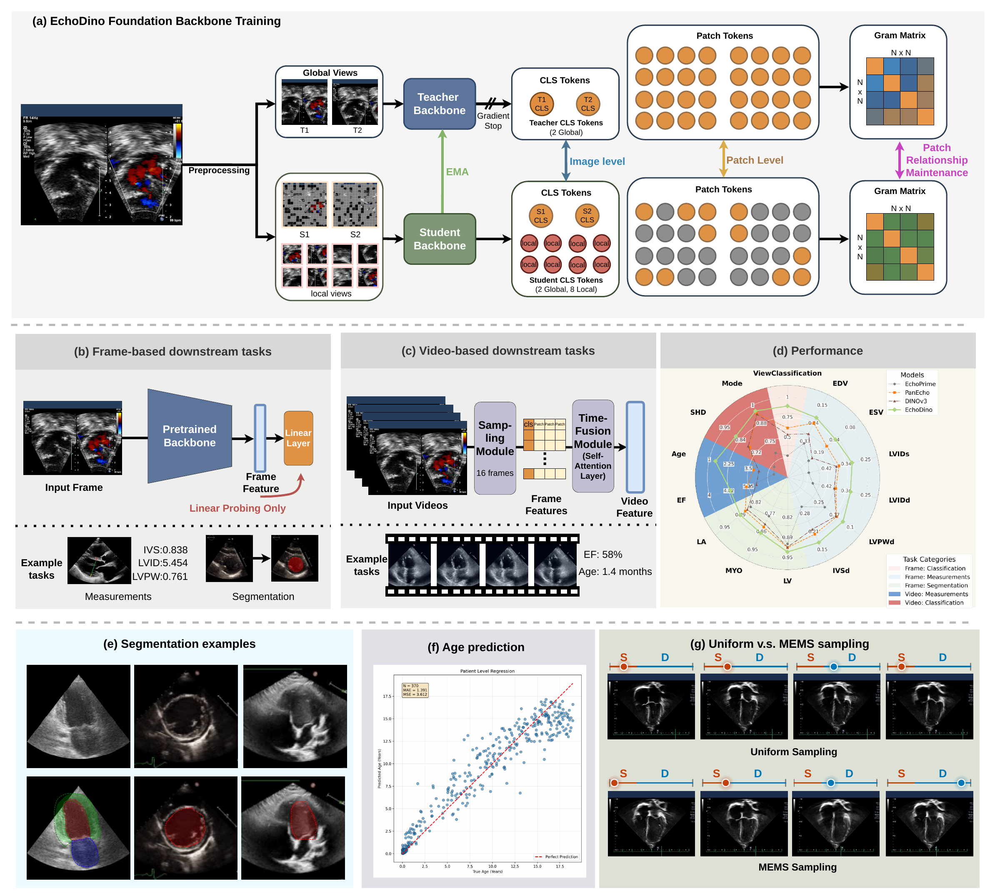](EchoDino_arch.pdf)

**Architecture overview.** EchoDino adapts a DINOv3 ViT-L/16 backbone through image-level self-distillation, masked patch prediction, and Gram anchoring to preserve relationships between patch features. The figure also shows the frozen-backbone readouts and MEMS frame sampling used in the paper's downstream experiments. [View the full-resolution PDF](EchoDino_arch.pdf).

## Examples

The notebooks below demonstrate segmentation tracking and PCA visualization using EchoDino patch features. See [Running the examples](#running-the-examples) for setup instructions.

### Segmentation tracking

Starting from an annotated first frame, EchoDino patch features propagate the segmentation through the remaining video frames. The original sequence and segmentation overlay are shown side by side.

**Data source.** This segmentation tracking example uses data from [CAMUS (Cardiac Acquisitions for Multi-structure Ultrasound Segmentation)](https://www.creatis.insa-lyon.fr/Challenge/camus/). Dataset reference: S. Leclerc et al., ["Deep Learning for Segmentation using an Open Large-Scale Dataset in 2D Echocardiography"](https://doi.org/10.1109/TMI.2019.2900516), *IEEE Transactions on Medical Imaging*, 38(9), 2198–2210, 2019.

| Original video | Segmentation tracking |
| :---: | :---: |
| 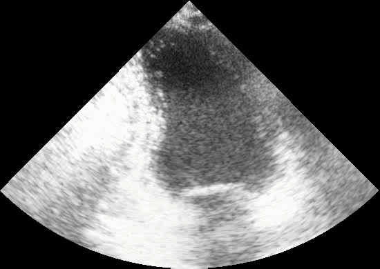 | 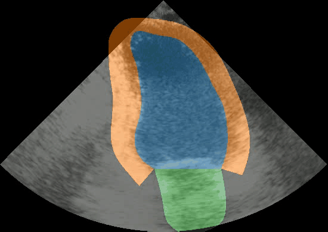 |
| [View original MP4](examples/resources/segmentation_tracking_output/input_my_echo.mp4) | [View segmentation MP4](examples/resources/segmentation_tracking_output/overlay_my_echo.mp4) |

The previews loop automatically. See [segmentation_tracking.ipynb](examples/segmentation_tracking.ipynb) for the example workflow.

### PCA feature visualization

Each row shows one echocardiography example: the **input image**, a **PCA color map of EchoDino patch features**, and the **overlay**. These visualizations map the last three of nine PCA components to RGB; PCA is fitted independently for each image.

| Example | Input / PCA / Overlay |
| :---: | :---: |
| 1 | 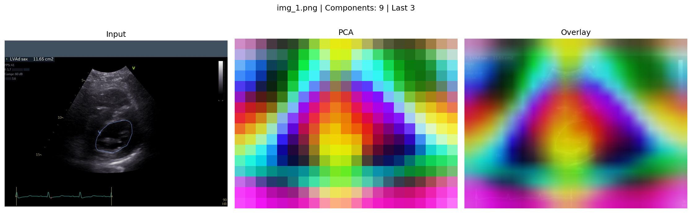 |
| 2 | 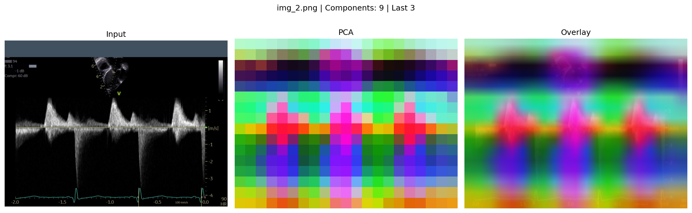 |
| 3 | 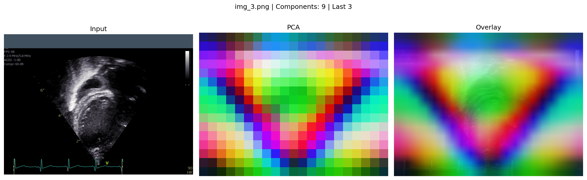 |

<details>
<summary>Show six more PCA examples</summary>

| Example | Input / PCA / Overlay |
| :---: | :---: |
| 4 | 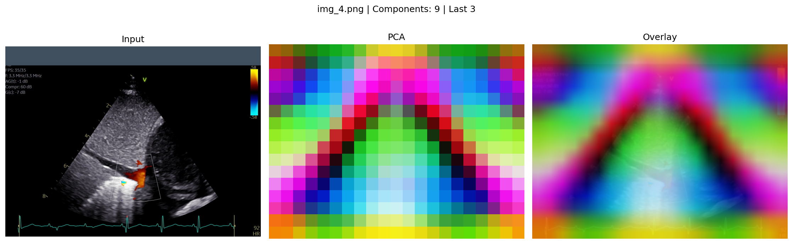 |
| 5 | 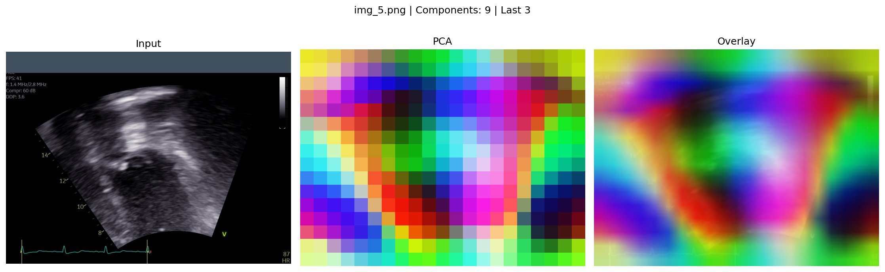 |
| 6 | 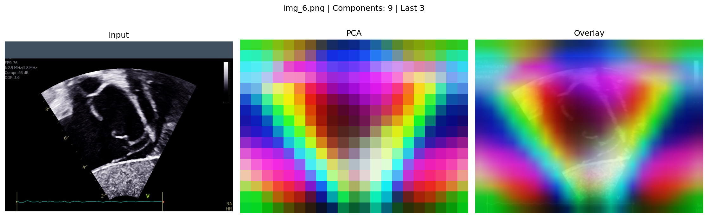 |
| 7 | 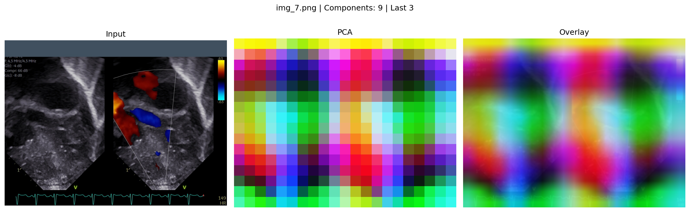 |
| 8 | 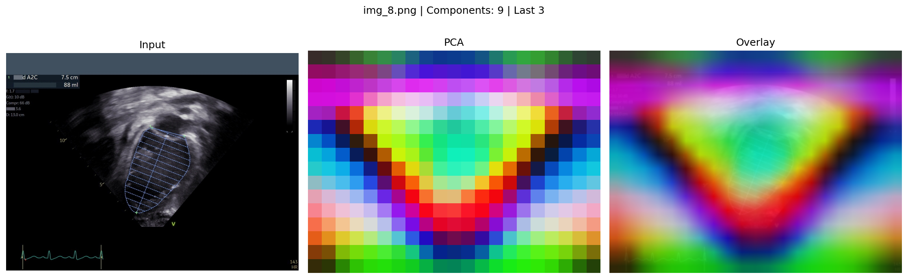 |
| 9 | 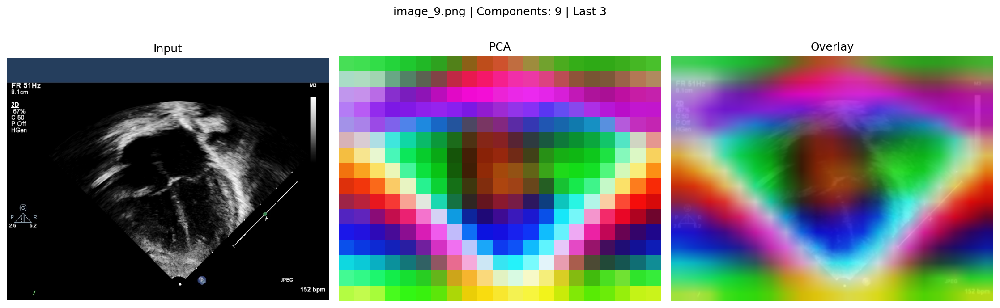 |

</details>

See [pca.ipynb](examples/pca.ipynb) for the example workflow.

### Running the examples

1. Prepare the [environment](#environment) and install the [notebook dependencies](#notebook-dependencies).
2. Open either notebook with `examples` as the working directory so its relative resource paths resolve correctly.
3. In the notebook's configuration cell, set `DINOV3_DIR` to the absolute path of this checkout and `WEIGHTS_PATH` to your EchoDino teacher checkpoint. Training produces these weights as described in [Training outputs](#training-outputs). Both notebooks use CUDA by default.

## Installation

This repository is based on Meta's official [DINOv3 implementation](https://github.com/facebookresearch/dinov3). It provides EchoDino's self-supervised backbone pretraining workflow and the example notebooks above. Pretraining has two stages: adaptation from pretrained DINOv3 weights, followed by continued training with Gram anchoring.

### Environment

Follow the official [DINOv3 installation instructions](https://github.com/facebookresearch/dinov3#installation) to prepare the training environment. Use Python 3.11 or newer, a compatible CUDA-enabled PyTorch/torchvision installation, and Linux with Bash for the launch scripts.

The current dataset module also imports `pydicom`. Install it in the same environment if it is not already available:

```bash
pip install pydicom
```

Run the EchoDino scripts from this checkout after activating the environment. The scripts set the Python module search path to this repository automatically.

### Notebook dependencies

To run the examples, install JupyterLab and the additional libraries imported by the notebooks in the same environment:

```bash
pip install jupyterlab matplotlib numpy Pillow scikit-learn opencv-python tqdm
```

### Changes from DINOv3

- **Gradient accumulation:** gradients are accumulated over five minibatches and averaged before each optimizer update. Learning-rate schedules, EMA teacher updates, Gram teacher updates, and checkpoint intervals follow optimizer-update counts.
- **Echocardiography data loading:** `EchoDinoPretrainingDataset` reads unlabeled image frames from a text file containing one image path per line. Labels and DICOM metadata are not supplied to the model.
- **Echocardiography augmentations:** frames are converted to RGB and normalized using ImageNet statistics. Training uses two 256 x 256 global crops and eight 96 x 96 local crops. Horizontal flips are disabled to preserve cardiac orientation, and color jitter changes brightness and contrast while leaving saturation and hue unchanged.
- **Pretrained initialization and training recipes:** stage 1 loads a pretrained DINOv3 ViT-L/16 backbone checkpoint. Stage 2 resumes the saved training state and uses a stage-1 teacher checkpoint for Gram anchoring. Separate configuration files and launch scripts describe the two stages.

The ViT backbone, DINO and iBOT objectives, and Gram-anchoring machinery are inherited from DINOv3.

## Training

### Dataset preparation

Prepare individual echocardiography image frames, such as PNG or JPEG files, before training. The pretraining loader reads image files; it does not extract frames from videos or decode DICOM files. Apply the preprocessing used for your experiment before creating the image list, including masking image overlays when reproducing the paper's preprocessing.

Create a UTF-8 text file with one image path per line, without a header or blank lines. For example, `image_paths.txt`:

```text
/path/to/frames/frame_000001.png
/path/to/frames/frame_000002.png
/path/to/frames/frame_000003.png
```

Use absolute Linux paths so the list works regardless of the working directory. For a folder of PNG/JPEG frames, a list can be generated with:

```bash
find /path/to/frames -type f \( -iname '*.png' -o -iname '*.jpg' -o -iname '*.jpeg' \) \
    | sort > /path/to/image_paths.txt
```

The dataset is implemented in [echoDino_pretraining_data.py](dinov3/data/datasets/echoDino_pretraining_data.py) and registered as `echodino`. Its configuration format is:

```yaml
train:
  dataset_path: 'echodino:root=/path/to/image_paths.txt:extra=unused'
```

Here, `root` is the image-list text file, and `extra` is a required but unused constructor argument. The launch scripts supply this setting from `IMAGE_LIST`. The training data is not included in this repository.

### Training recipe

The default recipe uses four GPUs, 48 images per GPU, and five gradient-accumulation steps. This gives 192 images per minibatch and an effective optimizer batch size of 960 images.

Throughout this README, a **training step** means one minibatch iteration. One optimizer update occurs every five training steps. The configured epoch length is 1,000 optimizer updates, so one configured epoch corresponds to 5,000 training steps.

| Stage | Configuration | `optim.epochs` | Training-step range |
| --- | --- | --- | --- |
| 1: adaptation from DINOv3 | [echodino_stage1_pretrain.yaml](dinov3/configs/train/echodino_stage1_pretrain.yaml) | 30 | 0 to 150,000 |
| 2: Gram continuation | [echodino_stage2_gram_continue.yaml](dinov3/configs/train/echodino_stage2_gram_continue.yaml) | 60, total endpoint | 150,000 to 300,000 |

The complete run contains 300,000 training steps and 60,000 optimizer updates. Stage 2 adds 150,000 training steps by resuming stage 1; its 60-epoch setting includes the first stage.

### Stage 1: adaptation from DINOv3

Obtain the pretrained DINOv3 ViT-L/16 backbone weights through the official [DINOv3 pretrained-model instructions](https://github.com/facebookresearch/dinov3#pretrained-models).

From the repository root, replace the example paths, set the environment variables, and launch stage 1:

```bash
export IMAGE_LIST="/path/to/image_paths.txt"
export OUTPUT_DIR="/path/to/echodino_output"
export DINOV3_CHECKPOINT="/path/to/dinov3_vitl16_checkpoint.pth"
export NPROC_PER_NODE=4

bash train_shell/train_stage1.sh
```

`DINOV3_CHECKPOINT` initializes the student backbone and EMA teacher from DINOv3 weights. Choose a new output directory for a new experiment. If an existing training checkpoint is present there, the trainer resumes it automatically.

### Stage 2: continuation with Gram anchoring

After stage 1 finishes, keep the same `IMAGE_LIST` and `OUTPUT_DIR`. In the same environment, launch stage 2:

```bash
export GRAM_TEACHER_CHECKPOINT="$OUTPUT_DIR/eval/training_149999/teacher_checkpoint.pth"

bash train_shell/train_stage2.sh
```

`GRAM_TEACHER_CHECKPOINT` defaults to this stage-1 teacher path, so setting it explicitly is optional. The teacher weights initialize the Gram teacher; the trainer separately restores the model, optimizer, and iteration counter from the latest numeric checkpoint directory under `$OUTPUT_DIR/ckpt`.

Stage 2 requires the saved training state and the Gram teacher checkpoint. Keep automatic resume enabled: loading teacher weights alone does not preserve the iteration counter needed for the 300,000-step endpoint.

Both scripts default to four GPUs and port 29500. Override `NPROC_PER_NODE` or `MASTER_PORT` as needed. Changing the GPU count changes the effective batch size.

### Training outputs

Full training checkpoints are saved under `$OUTPUT_DIR/ckpt/<iteration>/` for resuming training. Teacher weights are saved under `$OUTPUT_DIR/eval/training_<iteration>/teacher_checkpoint.pth`.

Iteration names are zero-based. The stage-1 endpoint is `training_149999`, and the final teacher checkpoint after 300,000 steps is:

```text
/path/to/echodino_output/eval/training_299999/teacher_checkpoint.pth
```

## Acknowledgments and license

We thank the DINOv3 authors for their implementation and pretrained models. See [LICENSE.md](LICENSE.md) for the DINOv3 license included with this repository.
